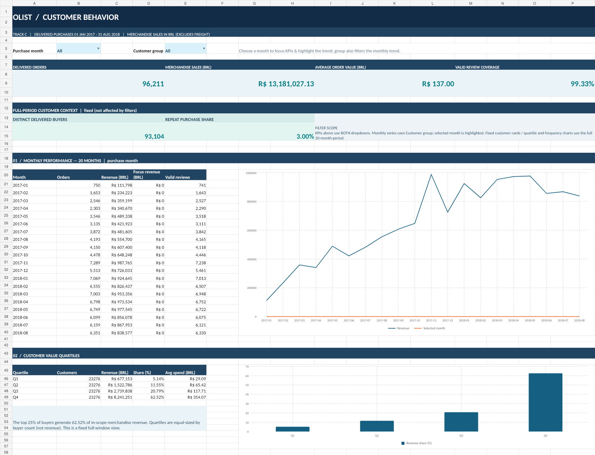

# Olist E-Commerce | Track C: Customer Behavior

**Course:** Business Intelligence SQL Project  
**Database:** Microsoft SQL Server, `OlistDB`  
**Analysis window:** `2017-01-01 <= order_purchase_timestamp < 2018-09-01`  
**Population:** Delivered orders unless a question specifically says otherwise; 2017–2018 historical snapshot.



## Why this project exists

The customer insights team wants to understand the distribution of merchandise spending, how often buyers return, which popular product categories are associated with repeat buying, and how delivery/review experiences differ for observed single-order versus repeat customers. This project answers **G1–G3, C1–C7 and O1–O2** using the anonymized Brazilian Olist marketplace data. Results are **descriptive**, not predictions of profit, churn or causal marketing returns.

## Key results verified against the original Olist CSVs

| Metric | Result |
|---|---:|
| Orders placed in period (all statuses) | 99,092 |
| Delivered orders | 96,211 |
| Unique delivered buyers (`customer_unique_id`) | 93,104 |
| Delivered merchandise sales (excludes freight) | **BRL 13,181,027.13** |
| Average delivered order value | **BRL 137.00** |
| Buyers with 2+ delivered orders | 2,789 (**3.00%**) |
| Top-spending quartile sales share | **62.52%** |
| Buyers above mean spending in their assigned state | 27,061 (**29.07%**) |
| Valid-review coverage for delivered orders | 95,568 / 96,211 (**99.33%**) |

The report explains all 12 questions and includes explicit limitations. **Use the outputs and counts rather than unverified effect claims.**

## Repository contents

```text
README.md
sql/
  00_setup.sql
  01_schema.sql
  01_views.sql
  02_validation.sql
  03_analysis.sql               # all 12 questions combined
  04_dashboard_exports.sql
  G1.sql ... G3.sql
  C1.sql ... C7.sql
  O1.sql, O2.sql
results/
  G1_status.csv ... O2_frequency_spend.csv
  dashboard_month_group.csv     # 40-row month x customer-group export
  C1_customer_detail.csv, C3_customer_state_comparison.csv
  G3_missing_matches_sample.csv, C6_first_second_sample.csv
docs/
  ER_Diagram.png, er_diagram.md
  data_dictionary.md
  sql_coverage_map.md
  source_validation.md
  questions_and_evidence.md
  dashboard_test_results.md
  run_order_and_qa.md
  contributions_template.md
dashboard/
  Track_C_Customer_Behavior_Dashboard.xlsx
  dashboard_preview.png
report/
  Track_C_Final_Findings.pdf
```

## Reproduce the project in SQL Server

**Already have `OlistDB` imported?** Keep the existing tables `dbo.customers`, `dbo.orders`, `dbo.order_items`, `dbo.order_payments`, `dbo.order_reviews`, `dbo.products`, `dbo.sellers`, `dbo.category_translation`. No need to rename or re-import again. Run in this order:

1. `sql/01_views.sql` (analytical views)
2. `sql/02_validation.sql` (source counts, duplicates, missing matches, invalid values, review ties)
3. `sql/03_analysis.sql` or the 12 individual question scripts
4. `sql/04_dashboard_exports.sql` (source tables for workbook)

**Fresh database:** Run `sql/01_schema.sql`, import eight original Olist CSV files with SQL Server Import and Export Data Wizard into those existing tables, then follow the order above. Record import options and rejected rows. See [run order and QA](docs/run_order_and_qa.md). SQL Server views preserve the original source rows.

**Original Olist dataset:** [Olist Brazilian E-Commerce Public Dataset on Kaggle](https://www.kaggle.com/datasets/olistbr/brazilian-ecommerce). The assignment lists its license as CC BY-NC-SA 4.0. CSV files and backup files are **not distributed in this GitHub repo**.

## Excel Dashboard

Open `dashboard/Track_C_Customer_Behavior_Dashboard.xlsx` in **desktop Microsoft Excel**. There are **four formula-derived KPI cards**, three functional charts (monthly sales, value-quartile share, purchase frequency), and two interactive **dropdown filter controls**: `B5` month and `E5` observed Single/Repeat customer group.

- Both dropdowns affect the 4 KPI cards.
- Customer group changes the monthly revenue chart; selecting a month highlights that month in the chart without hiding the rest of the timeline.
- The 93,104 unique buyers and 3.00% repeat rate, plus quartile/frequency charts, are deliberately **fixed to the complete observation period**, labelled as such.
- `Monthly_By_Group` contains sum/denominator components; `Reconciliation` checks 6 key values independently.
- All workbook data is embedded; no live connection is required to open it.

**Rubric caveat:** Excel controls here are formula-backed Data Validation dropdowns rather than native PivotTable slicers. Two meaningful dimensions work, but if your instructor strictly demands **native PivotTable/report filters or slicers**, this part needs an in-app PivotTable/slicer conversion. `docs/dashboard_test_results.md` explains test states and how to verify them.

## Method and limits

- Identify people with `customer_unique_id`; count distinct delivered orders by `order_id`.
- Revenue is **item price**, not marketplace profit; freight and payments are separate.
- `vw_order_sales` is one row per order, `vw_one_review_per_order` selects one valid score/order, and `vw_delivered_scope` preserves unmatched source order data.
- C3 assigns one state per buyer using their latest in-window delivered order.
- C5 compares category X (bed_bath_table) and Y (health_beauty), but the X+Y group has only 28 buyers, **below the 30 observation guideline for making action-grade rate recommendations**.
- From the original source, `category_translation` has 71 rows, but one earlier SQL Server screenshot reported 72; import needs verification. Other data-import issues and review ties are documented in `docs/source_validation.md`.
- Observed one-order buyers are not confirmed churned buyers. Comparisons are not causal. The SQL scripts have been reviewed syntactically and export figures recomputed from source CSVs, but **they have not been fully run against the user's local live SQL Server in this environment**.

