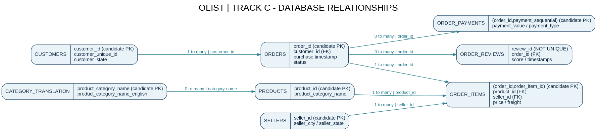

# Relational schema and grain

- `customers` has **one record per order-linked customer ID**, whereas `customer_unique_id` identifies a person across orders.
- `orders` has one row per order; joins `orders.customer_id = customers.customer_id`.
- `order_items` has one row per item, candidate composite key `(order_id, order_item_id)`, never SUM sequence ID.
- `order_payments` has one row per payment record, candidate key `(order_id, payment_sequential)`; payments must be summarized by order BEFORE joining item totals.
- `order_reviews` has raw source review rows, review_id not globally unique; views select one valid review per order.
- `products` and `sellers` are dimension tables joined by `product_id` and `seller_id` from items.
- `category_translation` maps Portuguese category to English using LEFT JOIN to retain unmatched categories.

**Views:** `vw_order_sales` one row per order (product revenue), `vw_one_review_per_order` one valid review per order, `vw_delivered_scope` one delivered order in the 2017-01 to 2018-08 window, `vw_customer_spend` one person, `vw_customer_latest_state` one assigned state per person, `vw_category_items` one order item (category joins are not additive across distinct customer counts).

Candidate key relationships are not claimed as enforced constraints unless the student explicitly creates them after validation.
